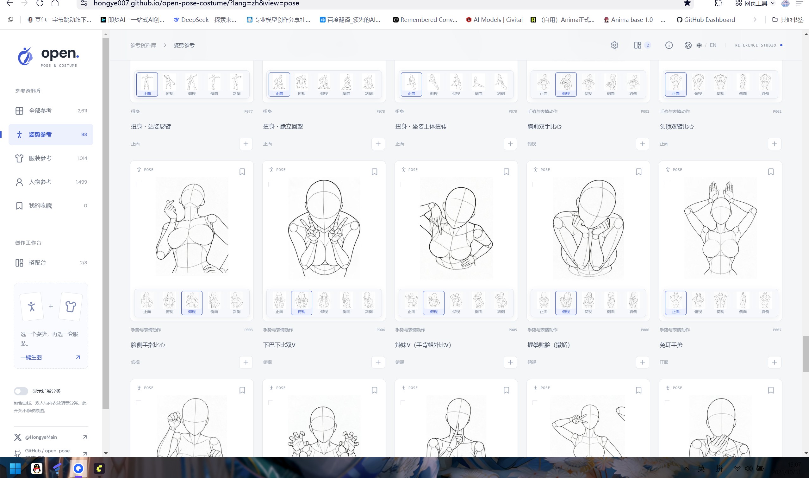
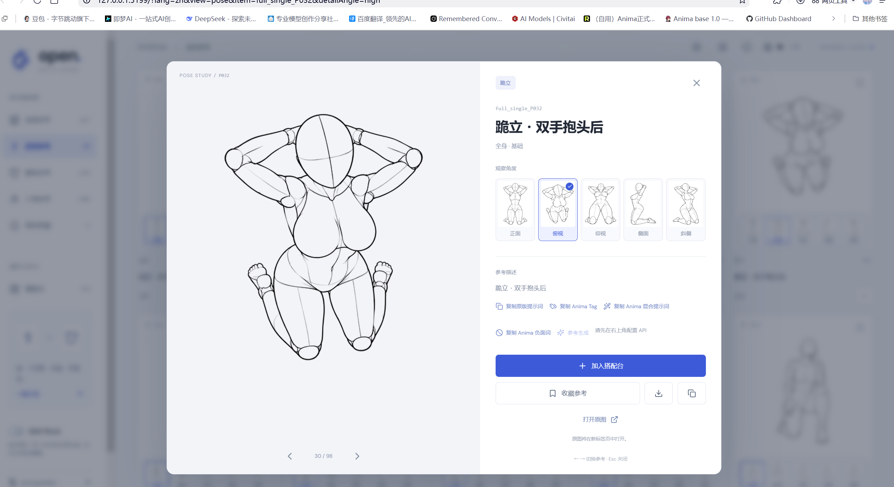
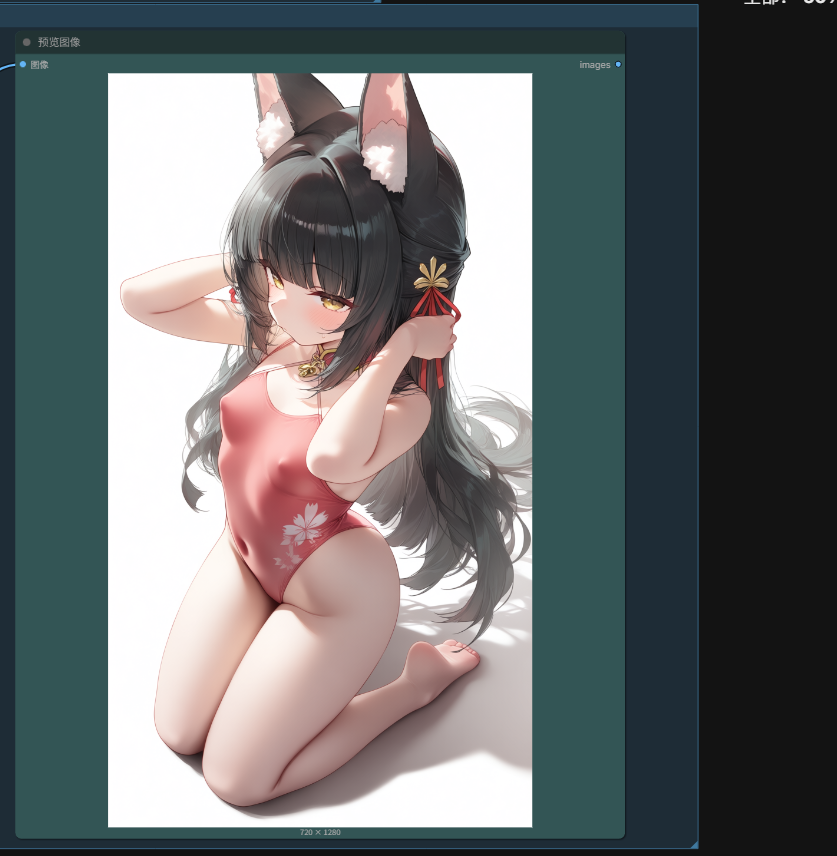
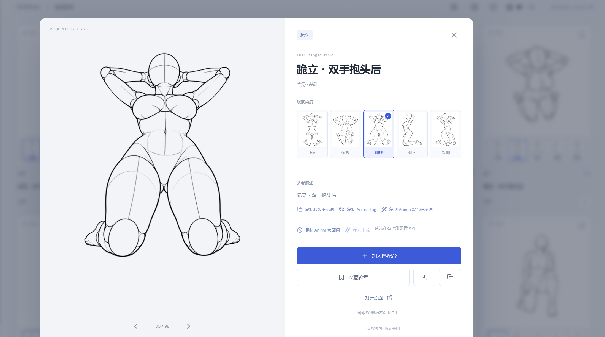
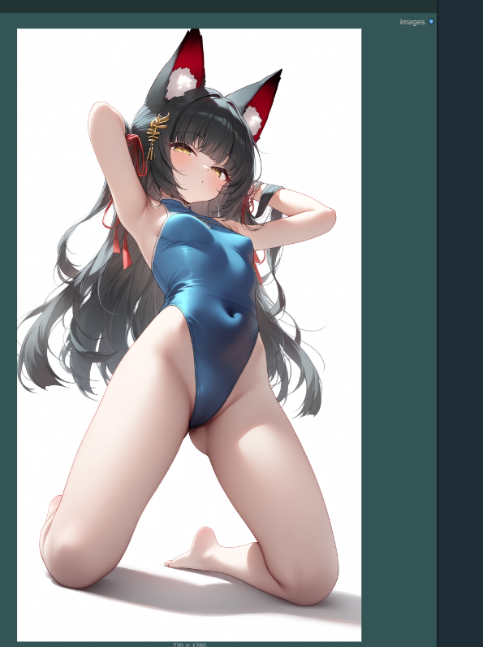

# Open Pose & Costume · Anima tags

A small addition to [hongye007/open-pose-costume](https://github.com/hongye007/open-pose-costume):
a few extra buttons next to the copy action that turn a pose or an outfit into
[Anima 1.0](https://huggingface.co/circlestone-labs/Anima)-friendly Danbooru tags.

**Buttons only.** The reference library, the data, the build pipeline and every existing
feature are untouched. See the original repository for the project itself.

- Original project: <https://github.com/hongye007/open-pose-costume>
- Live site: <https://hongye007.github.io/open-pose-costume/>



## What changed

In the detail panel and the pairing board, three small buttons sit next to **Copy original prompt**:

| Button | Output |
| --- | --- |
| 📋 Copy original prompt | The original natural-language description, unchanged |
| 🏷️ Copy Anima tags | Tags only, comma separated, ready for the positive box |
| ✨ Copy Anima mixed prompt | The tags plus two or three English sentences, matching the official mixed formula |
| 🚫 Copy Anima negative | The recommended negative prompt |

Tags follow the viewing angle you pick: `from below` for a low angle, `from above` for a high one.

## Result

The pose “kneeling, hands behind head”, high angle:



The copied tags, run through Anima in ComfyUI:



Same pose, low angle:





## Running it

```sh
npm ci
npm run dev
```

Then open <http://127.0.0.1:5199>. Tag vocabulary lives in `data/anima-lexicon.json`
and hot-reloads on save.

## Notes

- The code comes from the original project and stays under its author's copyright. This
  repository adds `data/anima-lexicon.json`, `src/anima.ts`, `src/anima-ui.tsx`,
  `tests/anima.test.mjs`, and two button mounts in `src/App.tsx`.
- Image usage rules are in [SOURCES.md](SOURCES.md) and on the original site; no assets are
  redistributed here.
