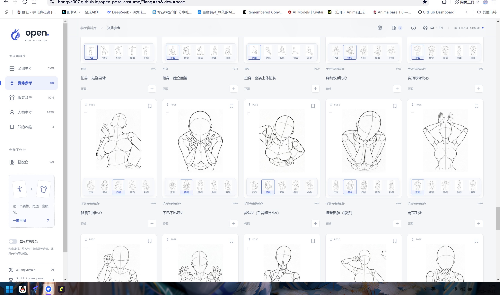
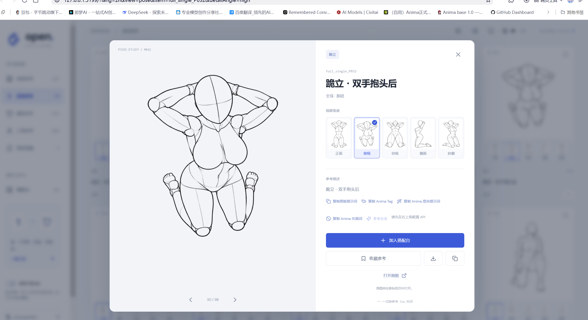
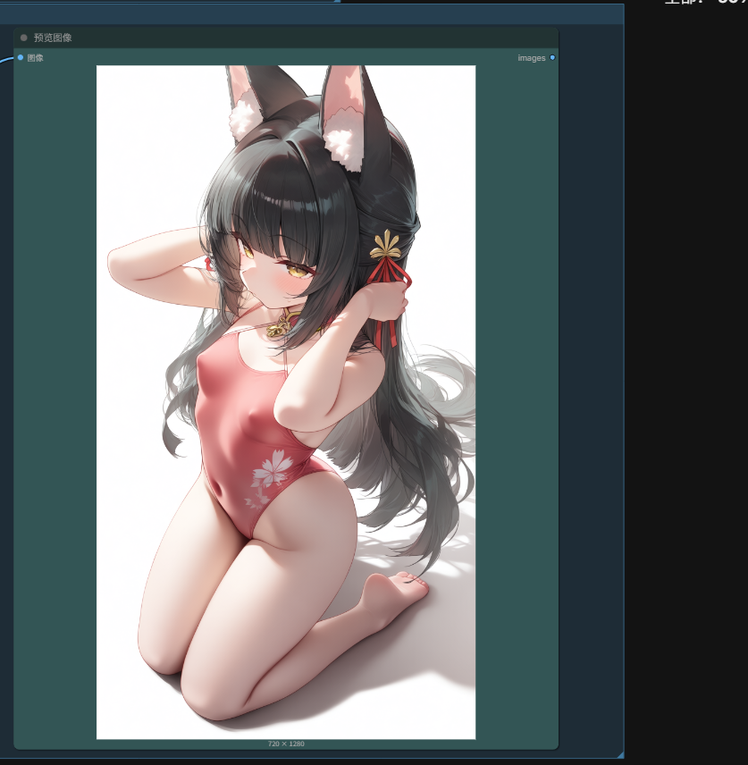
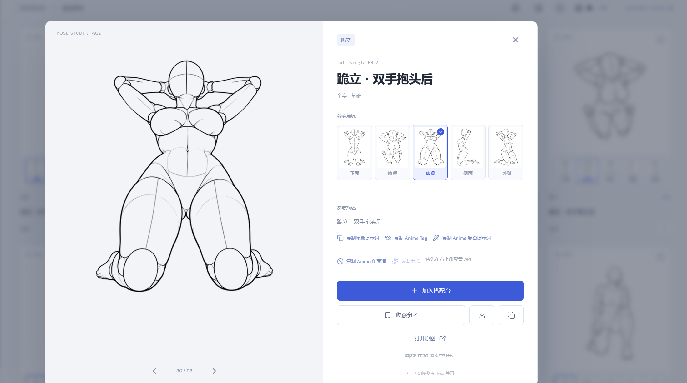
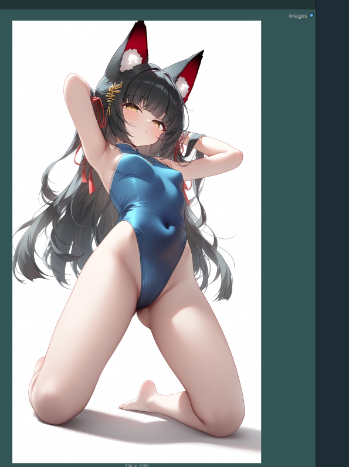

# Open Pose & Costume · Anima 标签版

给 [hongye007/open-pose-costume](https://github.com/hongye007/open-pose-costume) 加了一个小功能：
在「复制提示词」旁边多几个按钮，把参考库里的姿势和服装直接转成
[Anima 1.0](https://huggingface.co/circlestone-labs/Anima) 能用的 Danbooru 风格标签。

**只是加按钮，别的都没动。** 素材库、数据、构建流程、原有功能全部保持原样，
想了解项目本身请看原仓库。

- 原项目：<https://github.com/hongye007/open-pose-costume>
- 原站在线体验：<https://hongye007.github.io/open-pose-costume/>



## 改了什么

详情页和搭配台里，原来的「复制参考描述」旁边多了三个小按钮：

| 按钮 | 复制出来的内容 |
| --- | --- |
| 📋 复制原版提示词 | 原来的自然语言描述，一个字没改 |
| 🏷️ 复制 Anima Tag | 纯标签，逗号分隔，直接贴正向框 |
| ✨ 复制 Anima 混合提示词 | 标签 + 两三句英文自然语言，对应 Anima 官方推荐的混排写法 |
| 🚫 复制 Anima 负面词 | 官方建议的负面词，贴到负面框 |

标签会**跟着你选的视角走**：点「仰视」那张图就带 `from below`，点「俯视」带 `from above`。

## 效果

以「跪立・双手抱头后」为例，选**俯视**：



复制 Tag 丢进 ComfyUI 跑 Anima：



同一姿势换成**仰视**：





## 怎么用

本地跑起来：

```sh
npm ci
npm run dev
```

然后打开 <http://127.0.0.1:5199>。

想改标签词表就编辑 `data/anima-lexicon.json`，存盘后页面自动刷新：

| 字段 | 作用 |
| --- | --- |
| `quality` / `rating` | 质量词和分级，比如把 `safe` 换成 `sensitive` |
| `negative` | 负面提示词 |
| `phrases` | 姿势标题 → 标签的匹配规则 |
| `categories` | 分类兜底标签 |
| `angles` | 视角 → 构图标签 |
| `costume` | 服饰词表 |
| `overrides` | 按姿势 id 直接写死，优先级最高 |

## 说明

- 代码基于原项目，版权归原作者。本仓库实际只新增了 `data/anima-lexicon.json`、
  `src/anima.ts`、`src/anima-ui.tsx`、`tests/anima.test.mjs`，以及在 `src/App.tsx` 里加的两处按钮。
- 图片素材的使用规则见 [SOURCES.md](SOURCES.md) 和原站说明，本仓库不再分发素材。
- 示例图是本地跑出来的效果，实际结果取决于模型、LoRA 和参数设置。
